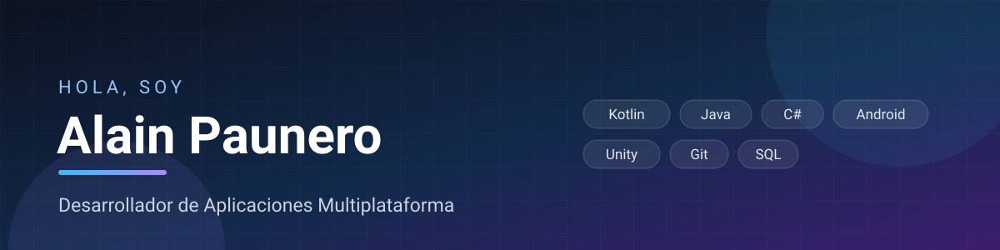

  

# 👋 Hola, soy Alain Paunero

**Desarrollador de Aplicaciones Multiplataforma** · **Técnico en Sistemas Microinformáticos y Redes**

Estudio DAM y vengo de sistemas: sé montar el equipo, configurar la red y desplegar la aplicación que escribo. Me interesa el software que se puede tocar y probar en más de un sitio, de una app Android a un juego en Unity.

## Sobre mí

- 🎓 Cursando el **Grado Superior en Desarrollo de Aplicaciones Multiplataforma (DAM)**, con el **Grado Medio en Sistemas Microinformáticos y Redes** ya terminado.
- 💻 Escribo **Kotlin** para Android, **Java** para escritorio y bases de datos, y **C#** en Unity.
- 🧰 Uso **Git** a regularmente y me manejo con entornos virtuales, emuladores y despliegues en dispositivo real.
- 🚧 Ahora mismo: **RunnersZ** (minijuego de descifrado en Unity), **CipherSprint** (cliente Android en Kotlin) y una **app de telemetría para moto** con Kotlin y Bluetooth.

## Skills

  
  
  
  
  
  
  
  

## Idiomas

| Idioma | Nivel |
| --- | --- |
| Español | Nativo |
| Inglés | Intermedio (B1) |

## Contacto

  
  

---

Abierto a prácticas y proyectos de desarrollo multiplataforma.
